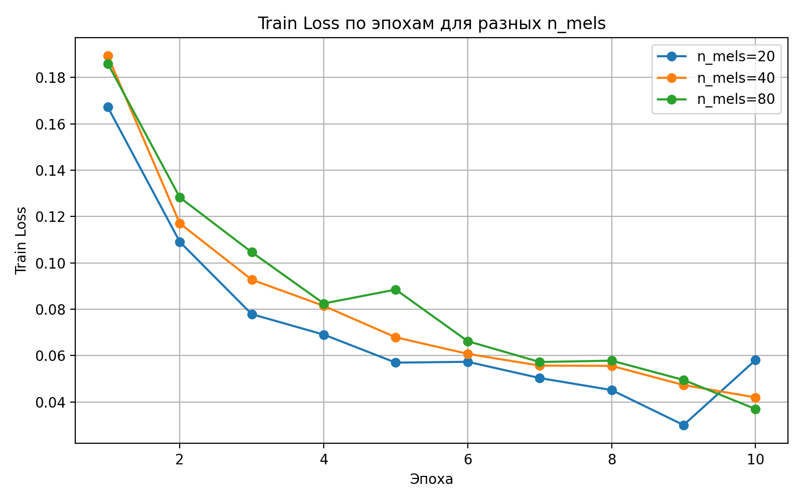
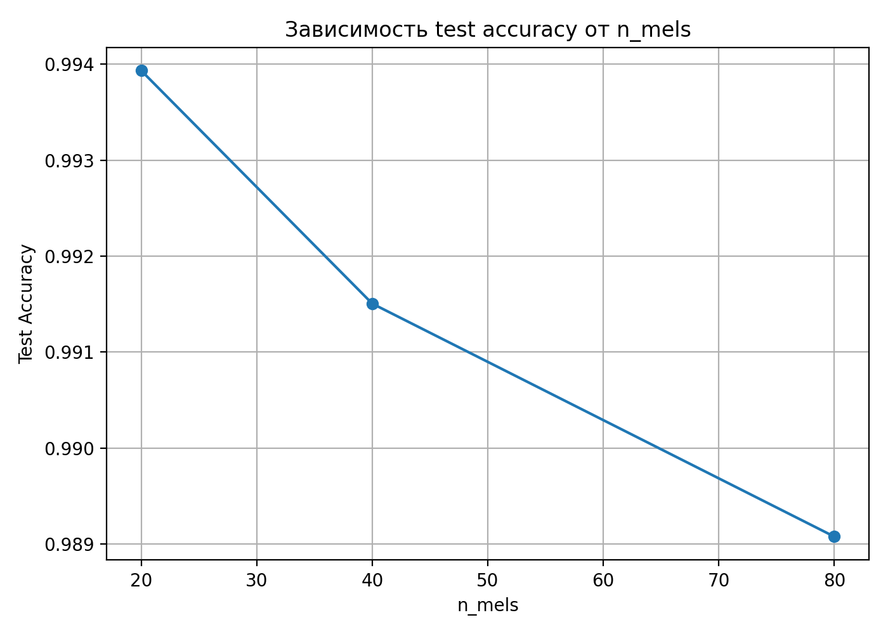
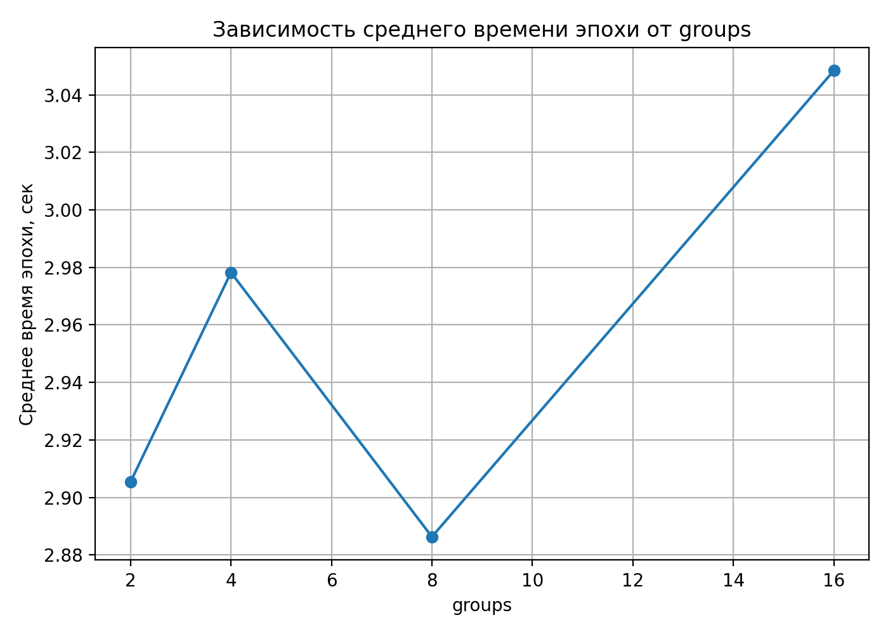
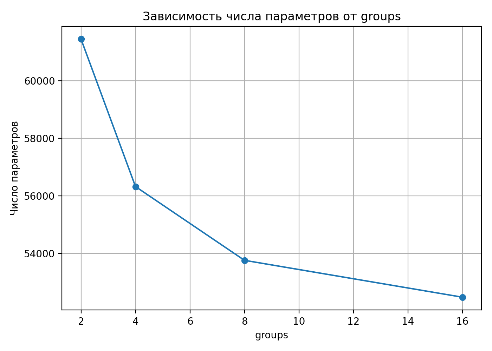
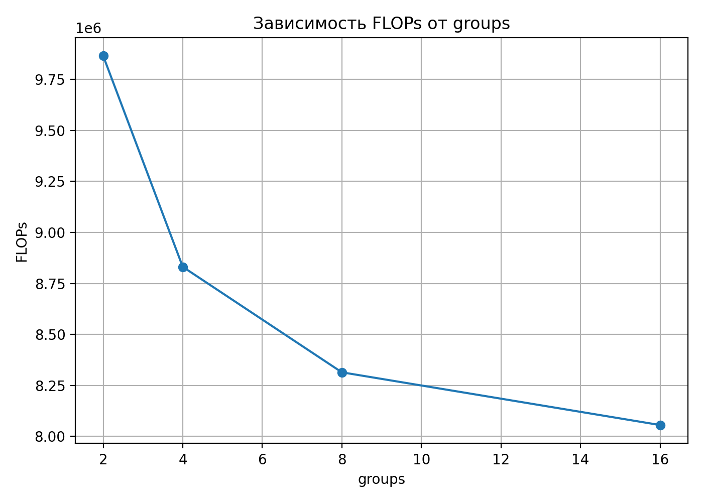
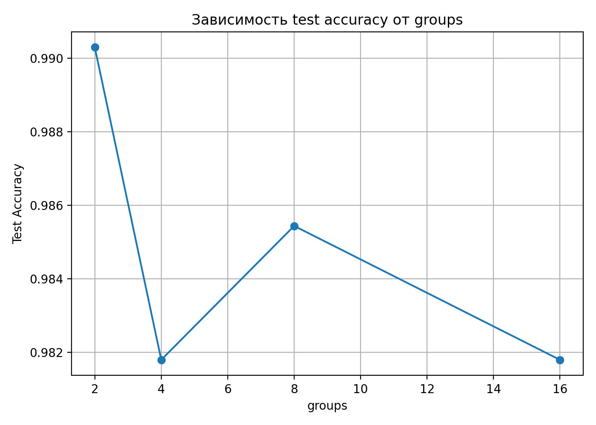
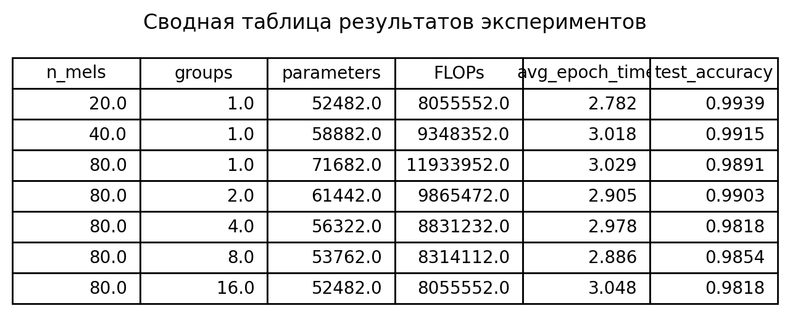

# Реализация Log-Mel Filterbanks и классификация речевых команд

## 1. Цель работы

Целью работы является реализация слоя извлечения признаков **Log-Mel Filterbanks** с использованием базовых операций PyTorch и обучение компактной нейронной сети для классификации речевых команд.

Задачи работы:

1. Реализовать слой **LogMelFilterBanks** без использования готовых аудио-трансформаций (кроме `melscale_fbanks`).
2. Проверить корректность реализации путём сравнения с `torchaudio`.
3. Обучить компактную **Conv1d модель** для бинарной классификации речевых команд **“yes”** и **“no”**.
4. Исследовать влияние параметров:
   - числа mel-фильтров `n_mels`
   - параметра групповых свёрток `groups`.

В качестве датасета используется **Google Speech Commands dataset**.

---

# 2. Реализация Log-Mel Filterbanks

Был реализован кастомный слой `LogMelFilterBanks`, наследуемый от `torch.nn.Module`.

Обработка аудиосигнала выполняется следующим образом:
 ```
 Аудиосигнал
↓
STFT (Short-Time Fourier Transform)
↓
Степенной спектр
↓
Mel-фильтрбанки
↓
Логарифм
```

Для вычисления STFT используется **окно Ханна**.

Основные параметры:

| Параметр | Значение |
|---|---|
| sampling rate | 16000 Hz |
| n_fft | 400 |
| hop_length | 160 |
| окно | Hann |

После вычисления STFT берётся **степенной спектр**:

\[
|STFT|^2
\]

Далее применяется матрица **mel-фильтрбанков**, полученная функцией:
`torchaudio.functional.melscale_fbanks`

На последнем этапе применяется логарифм:

\[
\log(x + 10^{-6})
\]

---

# 3. Проверка корректности реализации

Корректность реализации слоя проверялась сравнением с функцией:
`torchaudio.transforms.MelSpectrogram`

Поскольку стандартная реализация не применяет логарифм, сравнение проводилось с:
`log(MelSpectrogram + 1e-6)`

Результаты показали:

- совпадение размеров выходных тензоров
- успешное прохождение проверки `torch.allclose(...)`

Это подтверждает корректность реализации слоя `LogMelFilterBanks`.

---

# 4. Подготовка датасета

Используется **Google Speech Commands dataset**, доступный через `torchaudio`.

Исходная задача многоклассовой классификации была преобразована в **бинарную задачу**:
`yes` и `no`

Размеры выборок:

| Набор | Количество |
|---|---|
| Train | 6358 |
| Validation | 803 |
| Test | 824 |

Все аудиофайлы приводятся к фиксированной длине:
16000 сэмплов (1 секунда)


Если запись короче — выполняется **padding нулями**,  
если длиннее — выполняется **обрезка**.

---

# 5. Архитектура модели

Для классификации используется компактная **Conv1d нейронная сеть**.

Структура модели:
```
LogMelFilterBanks
↓
Conv1d
↓
BatchNorm
↓
ReLU
↓
MaxPool
↓
AdaptiveAvgPool
↓
Linear classifier
```
Количество параметров модели составляет примерно:
52K – 71K параметров
В обучении используются:

- функция потерь **CrossEntropyLoss**
- оптимизатор **Adam**

---

# 6. Обучение baseline модели

Базовая конфигурация модели:

| Параметр | Значение |
|---|---|
| n_mels | 80 |
| groups | 1 |
| batch_size | 32 |
| epochs | 10 |
| learning rate | 0.001 |

Результат на тестовой выборке:
Test accuracy ≈ 0.99

Это показывает, что даже компактная модель успешно решает задачу бинарной классификации речевых команд.

---

# 7. Эксперименты с числом mel-фильтров

Были проведены эксперименты с различным числом mel-фильтров:
`n_mels = 20`
`n_mels = 40`
`n_mels = 80`


### График обучения

<p align="center">

</p>

<p align="center">
Рисунок 1 — Train Loss при различных значениях n_mels
</p>

### Зависимость точности от числа mel-фильтров

<p align="center">

</p>

<p align="center">
Рисунок 2 — Точность модели при различных n_mels
</p>

Эксперименты показали, что уменьшение числа mel-фильтров не приводит к ухудшению качества модели.  
В некоторых случаях даже наблюдается небольшое улучшение точности.
---

# 8. Эксперименты с параметром groups

Параметр `groups` управляет использованием **групповых свёрток** в слое `Conv1d`.

Проверялись значения:
`groups = 2`
`groups = 4`
`groups = 8`
`groups = 16`

### Время обучения

<p align="center">

</p>

<p align="center">
Рисунок 3 — Зависимость времени эпохи от параметра groups
</p>

### Число параметров модели

<p align="center">

</p>

<p align="center">
Рисунок 4 — Зависимость числа параметров модели от groups
</p>

### Вычислительная сложность (FLOPs)

<p align="center">

</p>

<p align="center">
Рисунок 5 — Зависимость FLOPs модели от параметра groups
</p>

### Точность модели

<p align="center">

</p>

<p align="center">
Рисунок 6 — Зависимость точности модели от параметра groups
</p>

---

# 9. Сводная таблица результатов

<p align="center">

</p>

<p align="center">
Рисунок 7 — Сводная таблица результатов экспериментов
</p>

Таблица содержит основные метрики:

- число параметров модели
- количество FLOPs
- среднее время эпохи обучения
- итоговую точность на тестовой выборке.

---

# 10. Выводы

1. Реализован кастомный слой **LogMelFilterBanks** с использованием базовых операций PyTorch.
2. Корректность реализации подтверждена сравнением с `torchaudio`.
3. Компактная **Conv1d модель** успешно решает задачу бинарной классификации речевых команд.
4. Эксперименты показали, что:
   - уменьшение числа mel-фильтров не ухудшает качество модели
   - параметр `groups` влияет на число параметров и вычислительную сложность.
5. Использование **групповых свёрток** позволяет уменьшить размер модели и FLOPs без существенной потери точности.

Таким образом, проведённые эксперименты демонстрируют влияние архитектурных параметров на баланс между качеством модели и вычислительной сложностью.